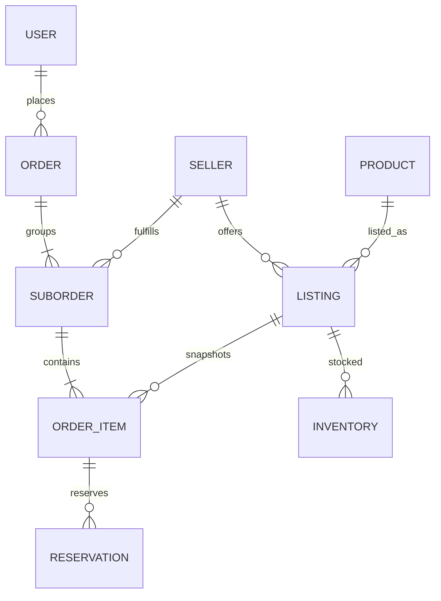
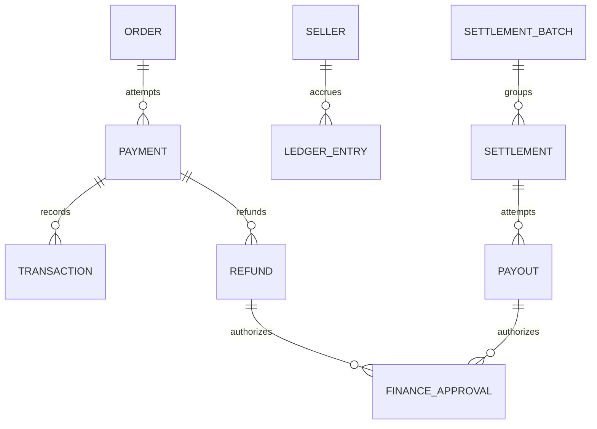

# Climo saree marketplace — architecture for approval

Status: proposed design; implementation has not started. Prepared 16 November 2026.

This design follows the attached FINAL MASTER DEVELOPMENT PROMPT. React and Node.js are the requested technologies. The proposal replaces the suggested Next.js frontend with React + Vite, retaining TypeScript, Express, PostgreSQL and Prisma. Customer storefront SEO will require deliberate prerendering or an SSR decision before production; a client-only storefront does not provide the same search indexing guarantees as SSR.

## 1. Scope and architecture

Three independently buildable React applications: customer-web, seller-portal and admin-portal. Finance uses protected routes in admin-portal with separately provisioned permissions. One Node.js Express modular monolith owns all business operations; a separate Node worker processes durable jobs. PostgreSQL is authoritative for stock, money, permissions and orders. Redis supports rate limiting, cache and job execution, never authoritative financial balances.

Frontend: React, TypeScript, Vite, React Router, Tailwind, accessible shared components, TanStack Query, React Hook Form and Zod. Backend: Express, TypeScript, Zod, Prisma, OpenAPI. All prices use integer paise with explicitly defined rounding; rates use basis points. No browser-supplied prices or roles are trusted.

Proposed repository: climo-marketplace, containing apps/customer-web, apps/seller-portal, apps/admin-portal, apps/api and apps/worker; packages/ui, packages/contracts, packages/domain and packages/database; docs, tests and infra directories. Each frontend has pages, features and API client layers. Backend modules each own routes, schemas, authorization, services and repositories. Only services may orchestrate cross-module transactions.

Server adapters: Razorpay payments/refunds, separately configured payout service, Shiprocket shipping, S3-compatible media, SMTP2GO email and a configurable AI provider. Missing credentials produce explicit unavailable/configuration states. Tests may use adapter doubles; production must never pretend a payment, shipment or payout succeeded.

## 2. Requirements and business rules

Sarees only. Public browsing; login required for checkout. Online payments only, no COD. Multi-seller carts split into seller suborders. Only active, verified sellers and approved listings are saleable. Super Admin owns brand/category/fabric/collection dictionaries, product and price approvals, banners/CMS, promotions, customer/seller operations and operational eligibility. Sellers can adjust their own stock with audit reasons. Orders retain immutable snapshots of prices, tax, commission, policies and seller legal details.

Free-shipping threshold is evaluated after product promotions and before cart coupons; shipping is calculated per fulfillment group below threshold. Proposed platform-wide threshold benefit is allocated proportionally across fulfillment groups. This allocation is a configurable policy, not a change to the required free-shipping rule. Commission precedence: seller+category, seller, category, platform. Default promotion stacking: one product promotion plus one eligible cart coupon.

Super Admin has read-only financial visibility. Only separately provisioned Finance can execute eligible refunds and authorize weekly payouts. Operational roles cannot grant Finance rights, directly or indirectly. Gateway events determine payment facts. Existing financial history is never overwritten by operational controls.

## 3. Database design and Prisma conventions

UUID primary keys; createdAt/updatedAt timestamps in UTC; explicit enums and foreign keys; actor IDs on changes. Money: BigInt paise serialized as strings in API contracts or bounded safe integers after validation. Quantities: bounded integers. Date ranges: start inclusive, end exclusive. Archive mutable catalog records; restrict deletion of order and ledger references. Sensitive verification/bank fields encrypted with externally managed keys; signed short-lived document access.

| Domain           | Proposed Prisma models and relationships                                                                           | Key constraints/indexes                                                                                   |
| ---------------- | ------------------------------------------------------------------------------------------------------------------ | --------------------------------------------------------------------------------------------------------- |
| Identity         | User → Session, Address, Consent, RoleAssignment; Role → Permission                                                | Unique normalized email; hashed session token; revokedAt; expiry index; finance assignments independent   |
| Sellers          | Seller → Verification, Document, StatusHistory, Warehouse, BankAccount, CatalogAuthorization                       | Unique verified identity digest as permitted by policy; seller status index; private document object keys |
| Catalog          | Brand, Category (parentId), Fabric, Collection; Product → Version, Media, Variant; SellerListing → Product, Seller | Unique slugs; seller+SKU uniqueness; approvedVersionId FK; status and seller indexes                      |
| Approval/pricing | ProductApproval → Version; PriceRequest → Listing/Variant; PriceHistory                                            | Version concurrency token; only one pending price request per target; effective-time index                |
| Inventory        | Inventory → Warehouse/Variant/Listing; Reservation → OrderItem; Movement                                           | Unique listing+variant+warehouse; nonnegative stock/reserved; conditional atomic updates                  |
| Marketing        | Banner, CmsPage, Promotion, PromotionScope, Coupon, CouponScope, Redemption, FlashSaleAllocation                   | Unique coupon code; time indexes; unique order+coupon; redemption reservation state                       |
| Shopping         | Cart → CartItem; WishlistItem; RecentlyViewed; StockRequest → SellerResponse                                       | Unique cart+listing+variant; unique wishlist target; partial unique active stock request                  |
| Commerce         | Order → Suborder → OrderItem; Payment → Transaction, WebhookEvent                                                  | Unique customer+idempotencyKey; unique gateway order/payment/event IDs; immutable item snapshots          |
| Fulfillment      | Shipment → ShipmentItem, ShipmentEvent; Cancellation → CancellationItem                                            | Unique provider shipment/AWB; ordered status transitions; item quantity bounds                            |
| After-sales      | Return → ReturnItem, Inspection; Exchange → ReplacementOrder; Refund → Approval                                    | Unique request idempotency keys; eligible quantity checks; refund amount bounded by captured balance      |
| Finance          | CommissionRule, LedgerEntry, SettlementBatch → Settlement → Payout; ReconciliationCase                             | Immutable double-entry postings; unique external/idempotency references; batch cutoff index               |
| Documents        | Invoice → InvoiceLine; CreditNote → CreditNoteLine                                                                 | Unique seller+fiscal-series+number; frozen tax and address snapshot; immutable PDF object                 |
| Engagement       | Review, ReviewMedia, HelpfulVote, ReviewReport; Question → Answer                                                  | Review eligibility via delivered order item; unique user+review vote                                      |
| Operations       | SupportTicket → Message, Attachment; Notification, ChatSession → ChatMessage                                       | Ownership indexes; internal-note visibility; deduplicated notification key                                |
| Governance       | AuditEvent, PlatformSetting, PrivacyRequest, FraudSignal, OutboxEvent                                              | Append-only audit; versioned settings; outbox retry/time indexes; PII redaction                           |

Custom SQL migrations supplement Prisma for CHECK constraints and partial unique indexes. Prisma schema files will implement these models after architecture approval. This is a schema design, not a generated or validated executable schema.

## 4. RBAC and financial boundaries

All authorization is server-side with resource ownership and seller-status checks. UI route guards are only a convenience. Deny by default; allowlisted operations; no generic endpoint may mutate payment, ledger, role or approval state.

| Action                                | Customer    | Seller                                     | Super Admin          | Finance              |
| ------------------------------------- | ----------- | ------------------------------------------ | -------------------- | -------------------- |
| Browse approved catalog               | Yes         | Yes                                        | Yes                  | Yes                  |
| Checkout, profile, order view         | Own         | Own customer account if separately allowed | Operational view     | Financial view       |
| Submit products/prices                | No          | Own authorized catalog                     | Review/control       | No                   |
| Stock adjustment                      | No          | Own, audited                               | Audited oversight    | No                   |
| Dictionaries/CMS/promotions           | No          | Request only                               | Manage               | No                   |
| Seller verification/status            | No          | Submit own documents                       | Review/manage        | No                   |
| Fulfillment                           | No          | Own suborders                              | Oversee              | Read relevant data   |
| Cancellation/return/exchange          | Request own | Fulfillment/inspection                     | Eligibility approval | Financial review     |
| Payment/refund/settlement records     | Own limited | Own earnings                               | Read-only            | Authorized scope     |
| Refund execution/payout authorization | No          | No                                         | Never                | Yes, eligible only   |
| Finance role provisioning             | No          | No                                         | Never                | No self-provisioning |
| Operational role management           | No          | No                                         | Allowlisted roles    | No                   |

Finance provisioned through a separate deployment/operator command or identity-administration process, audited and unavailable to Super Admin APIs. Require stronger authentication for privileged users and recent reauthentication for financial execution. Proposed dual-person review for high-value payouts is configurable, pending business threshold selection.

## 5. API and module inventory

REST prefix /api/v1. Standard pagination, filters and structured errors {code,message,fieldErrors,requestId}. Frontend displays safe backend business errors; unexpected internals are redacted with a useful reference ID. Every write validates schema, authorization, ownership and current state. Sensitive writes use idempotency keys and version checks. Below, GET means reads and POST/PATCH means explicit command endpoints; no unrestricted model CRUD.

| Module                 | APIs and screens                                                                                            | Validation, edge cases and tests                                                                                                                    | Dependencies                         |
| ---------------------- | ----------------------------------------------------------------------------------------------------------- | --------------------------------------------------------------------------------------------------------------------------------------------------- | ------------------------------------ |
| Auth/profile           | POST /auth/register, login, logout, forgot-password, reset-password; GET /auth/me; /me/addresses, sessions  | Email verification, secure password hashes, cookie sessions, CSRF, rate limits, session revocation, reset token reuse tests                         | Email, Redis                         |
| Sellers                | /seller/onboarding, profile, documents, warehouses, vacation; /admin/sellers/:id/verify,status              | Allowed status graph, rejection/suspension reasons, document expiry, no blocked login, no new sales while inactive; tenant isolation tests          | Private storage, verification policy |
| Dictionaries           | Public GET /brands,categories,fabrics,collections; admin writes and seller authorization endpoints          | Active/authorized selections, category cycles, slug uniqueness; seller-write denial tests                                                           | DB                                   |
| Catalog                | GET /products, /products/:slug; /seller/products and variants, submit; /admin/product-reviews/:id/decision  | Saree schema, mandatory image, unique SKU, material-change reapproval, existing approved version retained; version tests                            | Storage                              |
| Price approvals        | /seller/price-requests; /admin/price-requests/:id/decision                                                  | Positive prices, MRP bounds, old version conflicts, effective dates; pending-price leakage tests                                                    | Pricing                              |
| Inventory              | /seller/inventory, adjustments, movements; admin oversight                                                  | Reason required, available cannot go negative, reserved units cannot be removed; concurrent stock tests                                             | DB transactions                      |
| Banners/CMS            | GET /banners, /pages/:slug; /admin/banners, pages, homepage-sections                                        | Image/video validation, responsive assets, link allowlist, schedules, sort order; expired-banner tests                                              | Storage, jobs                        |
| Promotions             | /admin/promotions,coupons,flash-sales; GET /offers; POST /cart/quote                                        | Scope/date/first-order/limit/stacking checks, caps and deterministic rounding; concurrency tests                                                    | Pricing, jobs                        |
| Cart/wishlist          | /cart/items, merge, quote; /me/wishlist, recently-viewed                                                    | Idempotent guest merge, quantity bounds, unavailable item display, no trusted client totals                                                         | Catalog, pricing                     |
| Checkout/payments      | POST /checkout, /orders/:id/payment-attempts; /payments/verify; /webhooks/razorpay                          | Mandatory login, atomic reservations, gateway signature/raw-body verification, amount/currency/order matching; duplicate/out-of-order webhook tests | Razorpay                             |
| Orders/cancel          | GET /me/orders/:id; POST /me/orders/:id/cancellations; /seller/suborders/:id/transition                     | Item-level shipped/cancel race, partial quantities, no duplicate restock, immutable history                                                         | Inventory, finance                   |
| Shipping               | /shipping/serviceability, quotes; /seller/shipments; /webhooks/shipping; /orders/:id/tracking, labels       | Server-calculated rates, signed/authenticated webhooks, shipment ownership, tracking event deduplication                                            | Shiprocket                           |
| Returns/exchanges      | /me/returns, exchanges; /admin/returns/:id/decision; /seller/returns/:id/inspection                         | Delivered quantity/window policy, evidence security, no double return, replacement stock; full state-machine tests                                  | Shipping, inventory                  |
| Refunds                | /admin/refund-eligibility; /finance/refunds/:id/authorize, execute; GET /refunds/:id                        | Operational eligibility distinct from authorization, balance locks, idempotency, uncertain gateway outcomes; Admin execution denial tests           | Razorpay                             |
| Commission/settlements | /admin/commission-rules; /seller/earnings; /finance/batches, payouts/:id/authorize, execute, reconciliation | Rule precedence, weekly cutoff, return holds, failed retry, ledger conservation, no finalized edits                                                 | Payout provider, worker              |
| Invoices/tax           | /orders/:id/invoices; /seller/tax-reports; /finance/credit-notes                                            | Seller-specific invoice series, immutable snapshots, credit note bounds, totals reconcile                                                           | Confirmed tax policy, PDF renderer   |
| Stock requests         | /me/stock-requests; /admin/stock-requests/:id/forward, notify; /seller/stock-requests/:id/respond           | No duplicate active request, original seller routing, alternative requires consent, no automatic order/reservation                                  | Notifications                        |
| Reviews/Q&A            | /products/:id/reviews, questions; /questions/:id/answers; /admin/moderation                                 | Verified purchase requirement, own-review editing limits, reporting, vote uniqueness, safe media                                                    | Storage                              |
| Engagement             | /me/alerts, notifications, consents; /newsletter                                                            | Opt-in marketing, unsubscribes, per-user deduplication, restock/price-drop truthfulness                                                             | Email/jobs                           |
| Support                | /me/tickets, /tickets/:id/messages; /admin/tickets, assignment; seller scoped replies                       | Customer/seller ownership, internal notes hidden, attachment authorization, resolution audit                                                        | Storage, notifications               |
| Chatbot                | POST /assistant/messages; restricted internal catalog/order tool layer                                      | Grounded products/prices only, account verification, injection-resistant permissions, no autonomous finance writes                                  | AI adapter, catalog/order APIs       |
| Reports                | /admin/reports, /seller/reports; /finance/reports; /exports/:id                                             | Date/timezone boundaries, role filtering, large export jobs, formula-injection safe CSV                                                             | Worker                               |
| Governance             | /admin/audit-events, settings, fraud-signals; /me/privacy-requests                                          | Append-only audit, account deletion retains required transactions, export ownership, sensitive field redaction                                      | Retention policy                     |
| Bulk operations        | /seller/imports/products, /seller/bulk-fulfillment, /exports                                                | CSV/XLSX row errors, limits, partial-result reports, approval unchanged, vacation restrictions                                                      | Worker, storage                      |

## 6. Screen inventory

Customer public: home, catalog/category/brand/collection listings, new arrivals, best sellers, trending, offers/flash sales, search, product gallery/zoom/variants, about, contact, FAQ and privacy/terms/shipping/return/cookie policies. Authentication: register, verification, login, reset. Account: profile, addresses, sessions, wishlist, cart, checkout, payment result/retry, orders/detail/tracking/invoices, returns/exchanges/refund status, stock requests, notifications, alerts, consent/privacy requests and support. Assistant available with authenticated account tools only after login.

Seller: dashboard, onboarding/business/bank/pickup/return profile, verification/resubmission, products/variants/media, approvals and rejection history, price requests, inventory/warehouses/movement history/low-stock, CSV/XLSX imports and errors, assigned orders/packing/bulk labels, shipments, returns/inspection/exchanges, stock requests, earnings, settlements, invoices/tax reports, performance reports, vacation, support and notifications.

Admin: analytics; customers; sellers/verification/status history; brands/categories/fabrics/collections/authorizations; product/version/price reviews; inventory; banners/preview/schedules; CMS/homepage/footer/policies; promotions/coupons/flash sales; parent orders/suborders/shipping/cancellations; return/exchange eligibility; stock request routing; invoices; read-only payments/refunds/settlements/reconciliation; reviews/Q&A moderation; support; assistant configuration; notifications; reports/exports; operational roles; audit/settings/fraud/privacy queues.

Finance protected workspace: eligible refund queue, financial authorization, execution/retry/status, weekly batches, seller settlement statements, payout authorization/execution, reconciliation cases, ledger/report views and credit notes. No role dropdown changes privileges.

## 7. State machines and transaction boundaries

1. Seller approval: pending documents → review → active/rejected; rejection explains remediation. Active → inactive/suspended/blocked records actor/reason/time. Every public listing and checkout joins current seller eligibility. Inactive/suspended sellers retain narrowly authorized outstanding-order operations; blocked login is denied. Reactivation is reviewed and audited.
2. Product approval: draft → submitted → pending review → approved/rejected. Each submission freezes a version. Approval atomically switches approvedVersionId; pending edits never overwrite the public version. Explicit disable hides immediately.
3. Price approval: proposed old/new price + effective date → review → approval/rejection. Verify expected current price version; approval schedules/activates new version; retain history and charged order snapshots.
4. Pricing: regular price → one eligible product promotion → merchandise subtotal → eligible cart coupon → allocated shipping → configured taxes → payable. Show effective price, MRP and savings consistently. Coupon discount allocated by deterministic largest-remainder rounding for partial refunds; totals must reconcile exactly. No negative line values.
5. Inventory: checkout transaction locks relevant inventory rows in stable order; conditional reserve requires available >= requested. Coupon capacity reserved in same transaction. Persist order, item snapshots and expiry. Committed outbox triggers gateway attempt. Expiry worker releases once; failure/cancellation releases only unreleased allocations.
6. Multi-seller checkout: revalidate seller/product/price/stock/address/serviceability → quote → reserve → parent order and seller suborders → gateway order → verified payment → confirmed. No database transaction remains open across provider calls. Persist provider attempts and use idempotency/reconciliation for crashes.
7. Payment: preserve raw webhook body; verify signature; deduplicate event; validate gateway order, currency and amount. Record financial event atomically with transitions and outbox. Failed browser confirmation never overrides captured payment. A late capture after reservation expiry goes to explicit recovery: re-reserve if possible or Finance refund eligibility; never silently oversell.
8. Cancellation: lock eligible item and shipment state; before handover allow configured quantities; record cancellation and release/restock exactly once. Captured orders create refund eligibility; no Admin endpoint sends money.
9. Returns: customer reason/evidence → operational eligibility → reverse pickup → inspection → refund eligibility → Finance authorization → provider refund → verified outcome. Window and policy version are from purchase snapshots. Partial returned/cancelled quantities cannot exceed purchased units.
10. Exchanges: eligibility → reserve replacement → reverse pickup/inspection → replacement suborder/shipment. Release replacement if expired/rejected; confirm any alternative explicitly. Price difference policy must be configured before enabling non-equivalent exchange.
11. Refund: lock captured/refunded/pending amounts; require eligible inspected/cancelled quantities and Finance authorization; unique execution key; persist pending before provider call. Timeout means unknown pending outcome, not retry under a new key. Reconcile until authoritative success/failure. Reject sums above refundable amount.
12. Weekly settlement: proposed Monday 10:00 Asia/Kolkata batch, previous Sunday 23:59:59 cutoff. Only delivered orders beyond configured return/hold period qualify. Snapshot commissions, fees, shipping and refund adjustments. Finance authorizes frozen batch; payout provider execution records reference; uncertain attempts reconciled. Reverse/adjust through new ledger entries, never edit finalized ones. Schedule/cutoff remain configurable.
13. Stock requests: customer request → Admin routes to original seller → seller quantity/ETA/remarks → Admin reviews/notifies → customer accepts equivalent if offered. No automatic sale or stock hold.
14. Notifications and jobs: DB outbox transactionally records intent, worker claims/retries with deduplication and dead-letter visibility. Jobs cover schedules, expiry, alerts, invoices, imports, settlements and reconciliation. Provider outage leaves visible pending status.

## 8. Security, testing and operational readiness

Session cookies: HttpOnly, Secure in production, scoped SameSite; CSRF protection for cookie-auth writes; explicit CORS origins; server-side revocation. Passwords use a maintained adaptive hash implementation. Uploads enforce size, extension and actual file signature, malware/quarantine policy, private verification buckets and safe image transformation. Logs redact secrets and PII. Rate limits cover auth, checkout, coupon, chat and upload endpoints. No frontend bundle contains provider secrets.

Testing gates: unit tests for paise/rate arithmetic, coupon eligibility, commissions and transition graphs; PostgreSQL integration tests for atomic reservations, concurrent coupon use, financial locks, ownership and audit; adapter contract tests and real provider sandbox verification; browser tests for all three portals including multi-seller checkout, rejected approvals, suspension, returns and Finance isolation. Explicitly test duplicate/out-of-order/late webhooks and Admin attempts to grant itself Finance. No production-ready label until security, concurrency, restore and integration checks pass.

CI: lockfile install, typecheck, validation/schema migration checks, unit/integration tests, portal builds, relevant E2E and dependency/secret scanning. Staging migrations and seed fixtures separated from production. Seeded passwords never shipped as production access. Health/readiness endpoints report DB and worker dependencies. Structured request IDs, error monitoring, queue-age and reconciliation alerts. Backup retention and restore exercises must be configured and verified before launch.

Deployment: Docker containers for Express API and worker; PostgreSQL and Redis services; static React builds behind HTTPS with /api reverse proxy. Separate staging/production databases, buckets and gateway credentials. Migration job before compatible application rollout; rollback image plus forward-safe migrations. The requested Node backend needs a Node-capable host; do not substitute a Worker backend silently. Hosting provider remains a deployment decision.

Delivery: one GitHub monorepo, reviewable commits, source ZIP excluding secrets/node_modules/build caches, README with local setup, .env.example, migrations, seed fixtures, OpenAPI, tests, operational guide and feature verification matrix. A ZIP download link lets the user save locally; it does not automatically place files in their Windows Downloads directory.

## 9. Implementation roadmap and acceptance

| Phase | Result                                            | Exit condition                                                               |
| ----- | ------------------------------------------------- | ---------------------------------------------------------------------------- |
| 1     | Workspace, DB/migrations, auth and RBAC           | Real persistence, tenant isolation and Finance isolation tested              |
| 2     | Seller onboarding/admin dictionaries              | Status/verification and catalog authorization tests pass                     |
| 3     | Catalog/media/versions/prices/inventory           | Approval and concurrent stock behavior verified                              |
| 4     | Responsive storefront/CMS/search/cart/wishlist    | API-backed customer journeys, responsive/accessibility checks                |
| 5     | Pricing/promotions/coupons/flash sales            | Exact totals, scope limits and concurrent redemption verified                |
| 6     | Checkout/payments/orders/invoices                 | Multi-seller sandbox checkout and signed event tests pass                    |
| 7     | Shipping/after-sales/Finance/settlements          | Tracking, eligibility, refund and payout authorization verified              |
| 8     | Stock requests/reviews/support/chat/notifications | Account-safe tools and complete workflow journeys verified                   |
| 9     | Production hardening and delivery                 | Deployment, backups/restore, security/performance checks and documented gaps |

Each phase retains the entire agreed scope; none is presented as the finished marketplace while mandatory modules remain incomplete. Maintain a requirements-to-code/test matrix mapping all 40 mandatory rules and sections 1–39 of the source prompt.

## 10. Decisions and external dependencies

Needed before code: approval of React + Vite / Express / PostgreSQL + Prisma / Redis architecture and repository destination. Proposed name: climo-marketplace. The connected GitHub account is abhignanvemu2; no repository has been selected or modified.

Needed before live integrations/launch, without blocking unrelated development: Razorpay test/live account configuration and webhook secret; approved payout service and beneficiary process; Shiprocket credentials and seller pickup mappings; S3 credentials/bucket/CORS; sender/domain configuration; AI provider; domain/hosting/monitoring; independent Finance operator identity. Secrets belong in protected environment settings, not source or chat.

Business configuration before launch: seller-of-record and confirmed GST/invoice/TCS/TDS treatment from the business's tax adviser; return/exchange windows and non-equivalent exchange price policy; shipping rates/free threshold; commission defaults; settlement reserve period, schedule and financial approval limits; retention/consent text and policy documents. Tax behavior cannot be certified from the prompt alone. Proposed defaults in this document remain explicit proposals until approved/configured.

The source prompt says: “Do not start coding until the architecture is approved.” This document is the reviewable architecture package for that approval; it is not a completed application or evidence of a GitHub push.
